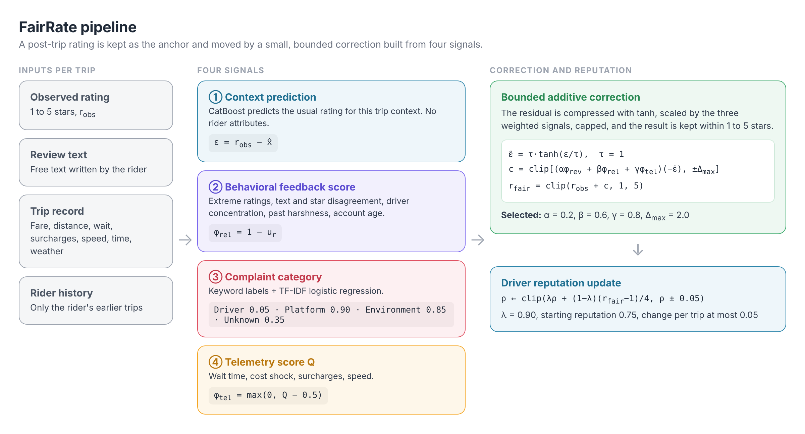
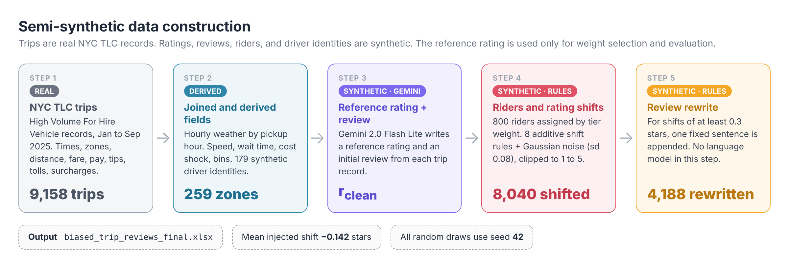
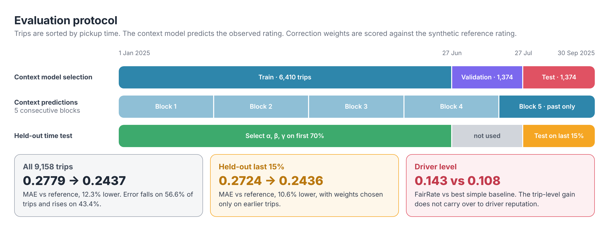
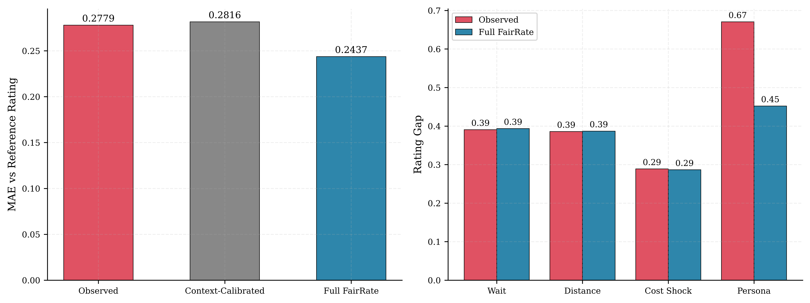
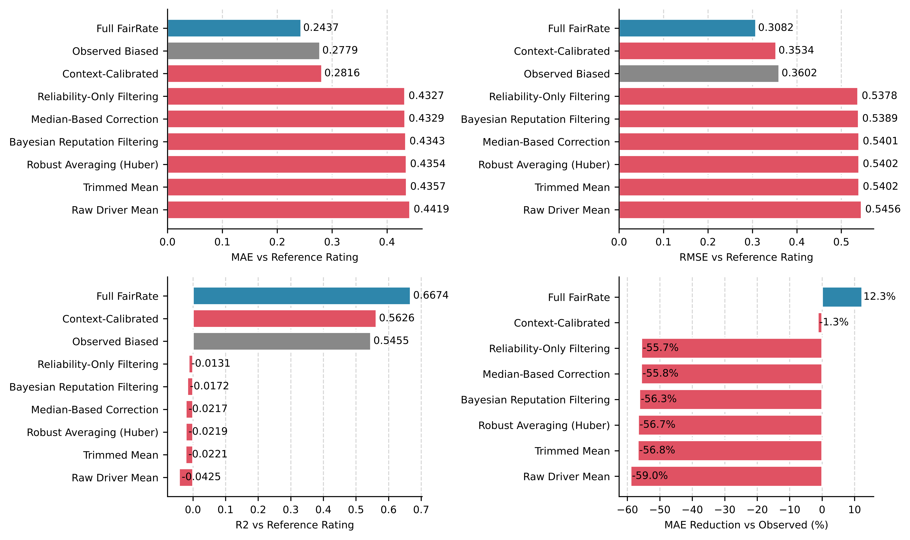

<div align="center">

# ⚖️ FairRate

### Examining Responsibility and Rating Correction in Ride-Hailing Reputation Systems

**Anonymous Author(s)**

*Submitted to ACM FAccT 2027 · Porto, Portugal*

<p>
<a href="https://facctconference.org/"></a>
<a href="#-citation"></a>
<a href="https://anonymous.4open.science/r/FairRate-Examining-Responsibility-and-Rating-Correction-in-Ride-Hailing-Reputation-Systems-47DD/"></a>
</p>

<p>
<a href="https://www.python.org/"></a>
<a href="https://jupyter.org/"></a>
<a href="https://catboost.ai/"></a>
<a href="https://www.nyc.gov/site/tlc/about/tlc-trip-record-data.page"></a>
<a href="#-reproducing-the-results"></a>
<a href="LICENSE"></a>
</p>

<p>
<a href="#-overview">Overview</a> ·
<a href="#-method">Method</a> ·
<a href="#-data">Data</a> ·
<a href="#-results">Results</a> ·
<a href="#-reproducing-the-results">Reproduce</a> ·
<a href="#-paper-to-file-map">Paper ↔ Files</a> ·
<a href="#-citation">Citation</a>
</p>

</div>

---

## 📌 Overview

A post-trip star rating can hold a driver responsible for problems the driver did not cause, such as traffic, weather, or surge pricing. Correcting those ratings brings its own risk, because it can weaken valid complaints about the driver.

**FairRate** is a prototype that studies this tension. It keeps the observed rating as the starting point and applies a small, bounded correction built from four signals. The corrected rating then updates the driver's reputation through a capped moving average.

> [!IMPORTANT]
> The evaluation is **semi-synthetic**. Trips come from real NYC TLC records. Ratings, reviews, riders, and driver identities are synthetic. All results measure recovery of a synthetic reference rating. They do **not** show fair treatment of real drivers.

## 🧭 Method

<p align="center">

</p>

| Signal | What it uses | Enters the correction as |
|---|---|---|
| 🔵 **Context prediction** | CatBoost on fare, distance, wait, surcharges, speed, time, and weather. No rider attributes. | residual ε = r<sub>obs</sub> − x̂ |
| 🟣 **Behavioral feedback score** | Only the rider's earlier trips. No persona, demographic, or tier labels. | φ<sub>rel</sub> = 1 − u<sub>r</sub> |
| 🔴 **Complaint category** | Keyword labels + TF-IDF logistic regression | Driver 0.05 · Platform 0.90 · Environment 0.85 · Unknown 0.35 |
| 🟠 **Telemetry score** | Wait time, cost shock, surcharges, speed | φ<sub>tel</sub> = max(0, Q − 0.5) |

Selected weights: **α = 0.2, β = 0.6, γ = 0.8**, cap Δ<sub>max</sub> = 2.0, reputation decay λ = 0.90, change per trip at most 0.05.

## 🗂️ Data

<p align="center">

</p>

<details>
<summary><b>The eight rating shift rules</b> (click to expand)</summary>

| Rule | Condition | Shift |
|:---:|---|:---:|
| 1 | Personality lenient / critical | +0.30 / −0.30 |
| 2 | Tier frequent / occasional / new | −0.20 / +0.05 / +0.15 |
| 3 | Age group young / senior | −0.10 / +0.20 |
| 4 | Late-night pickup and critical rider | −0.30 |
| 5 | Rain or snow and new rider | −0.25 |
| 6 | Wait above 5.47 min (75th percentile) and frequent rider | −0.30 |
| 7 | Fare above $35.27 (75th percentile) and young rider | −0.20 |
| 8 | Rider lives outside Manhattan and pickup in Manhattan | −0.15 |

All applicable shifts are added together. Gaussian noise (sd 0.08) is then added, and the result is clipped to 1 to 5 stars and rounded to one decimal.
</details>

## 📊 Results

<p align="center">

</p>

| Measure | Value |
|---|:---:|
| MAE vs reference, observed rating | 0.2779 |
| MAE vs reference, **FairRate** (all 9,158 trips) | **0.2437** (12.3% lower) |
| Trips with lower / higher error | 56.6% / 43.4% |
| Held-out time test (weights from first 70%, tested on last 15%) | 0.2724 → **0.2436** (10.6% lower) |
| Driver-level MAE, FairRate vs best simple baseline | 0.143 vs 0.108 |

<p align="center">
<br>
<sub><b>Left.</b> MAE against the synthetic reference. <b>Right.</b> Rating gaps across groups before and after correction.</sub>
</p>

<details>
<summary><b>Comparison with traditional reputation methods</b> (click to expand)</summary>
<p align="center">

</p>
</details>

> [!NOTE]
> The trip-level gain does not carry over to driver-level reputation. The rating gaps across wait, distance, and cost shock groups also stay almost unchanged. The paper discusses these limits in Sections 6 and 7.

## 🔁 Reproducing the Results

**1. Install.** Python 3.10 or later. These are the versions used to produce the results in this repository.

```bash
pip install pandas==3.0.5 scikit-learn==1.9.1 catboost==1.2.10 xgboost==3.4.1 \
            lightgbm==4.7.0 matplotlib==3.11.2 seaborn==0.13.2 \
            vaderSentiment openpyxl adjustText tqdm jupyter
```

**2. Run** the notebooks from the repository root, in this order.

| Step | Notebook | Produces |
|:---:|---|---|
| 1 | [`Biased_rideshare_dataset.ipynb`](Biased_rideshare_dataset.ipynb) | `biased_trip_reviews_final.xlsx`, `riders.csv` |
| 2 | [`FairRate_Notebook_v3.ipynb`](FairRate_Notebook_v3.ipynb) | `outputs/*.csv`, `all_figures/*` |
| 3 | [`FairRate_vs_Baselines.ipynb`](FairRate_vs_Baselines.ipynb) | `fairrate_vs_baselines_*.csv`, Fig. 5 |

```bash
jupyter nbconvert --to notebook --execute --inplace Biased_rideshare_dataset.ipynb
jupyter nbconvert --to notebook --execute --inplace FairRate_Notebook_v3.ipynb
jupyter nbconvert --to notebook --execute --inplace FairRate_vs_Baselines.ipynb
```

All random draws use seed 42. Step 1 rebuilds the dataset exactly. Steps 2 and 3 take a few minutes each on a laptop CPU.

## 🗺️ Paper to File Map

| Paper item | File |
|---|---|
| Table 3, shift rules | [`Biased_rideshare_dataset.ipynb`](Biased_rideshare_dataset.ipynb), section 4 |
| Table 4, Panel I | [`outputs/context_models.csv`](outputs/context_models.csv) |
| Table 4, Panel II | [`outputs/baselines.csv`](outputs/baselines.csv) |
| Table 4, Panel III | [`outputs/ablation.csv`](outputs/ablation.csv) |
| Table 5 | [`outputs/category_protection.csv`](outputs/category_protection.csv) |
| Fig. 2 | [`all_figures/fig2.png`](all_figures/fig2.png) |
| Fig. 4 | [`all_figures/fig4.png`](all_figures/fig4.png), [`outputs/parity_gap.csv`](outputs/parity_gap.csv) |
| Fig. 5 | [`all_figures/fairrate_vs_baselines.png`](all_figures/fairrate_vs_baselines.png), [`fairrate_vs_baselines_trip.csv`](fairrate_vs_baselines_trip.csv) |
| Sec. 4.2, cross validation | [`outputs/cv_consecutive_blocks.csv`](outputs/cv_consecutive_blocks.csv), [`outputs/cv_forward.csv`](outputs/cv_forward.csv) |
| Sec. 5.3, held-out time test | [`outputs/holdout_time_test.csv`](outputs/holdout_time_test.csv) |
| Sec. 6.5, driver-level comparison | [`fairrate_vs_baselines_driver.csv`](fairrate_vs_baselines_driver.csv) |
| Sec. 6.6, sensitivity | [`outputs/sensitivity.csv`](outputs/sensitivity.csv), [`all_figures/12_sensitivity.png`](all_figures/12_sensitivity.png) |
| Selected parameters | [`outputs/selected_parameters.csv`](outputs/selected_parameters.csv) |

## 📁 Repository Structure

```
.
├── trip_reviews.csv                    input: TLC trips, weather, driver IDs, reference ratings, initial reviews
├── Biased_rideshare_dataset.ipynb      step 1: build the semi-synthetic dataset
├── FairRate_Notebook_v3.ipynb          step 2: FairRate pipeline and main experiments
├── FairRate_vs_Baselines.ipynb         step 3: comparison with reputation baselines
├── biased_trip_reviews_final.xlsx      dataset produced by step 1
├── riders.csv / riders.xlsx            synthetic rider profiles produced by step 1
├── fairrate_vs_baselines_trip.csv      baseline comparison, trip level
├── fairrate_vs_baselines_driver.csv    baseline comparison, driver level
├── outputs/                            result tables from step 2
├── all_figures/                        figures from steps 2 and 3
└── assets/                             diagrams used in this README
```

## ⚠️ Limitations and Intended Use

- The reference rating is a synthetic target. It encodes the authors' assumptions, not an observed fair outcome.
- Complaint categories come from keyword labels, not human annotation.
- Correction weights are selected and evaluated on the same trips. The held-out time test is the only separate check.
- All trips come from one city over nine months.

This code is a **research prototype** for studying rating correction. It should not be used to change real driver reputations. Synthetic personality and demographic attributes are simulation inputs and say nothing about real populations.

## 📝 Citation

```bibtex
@inproceedings{fairrate2027,
  title     = {FairRate: Examining Responsibility and Rating Correction in Ride-Hailing Reputation Systems},
  author    = {Anonymous},
  booktitle = {Proceedings of the ACM Conference on Fairness, Accountability, and Transparency (FAccT)},
  year      = {2027},
  note      = {Under review}
}
```

## 📄 License

Code is released under the [MIT License](LICENSE). NYC TLC trip records are public data from the [NYC Taxi and Limousine Commission](https://www.nyc.gov/site/tlc/about/tlc-trip-record-data.page).

<div align="center">
<sub>Anonymized for double-blind review at ACM FAccT 2027.</sub>
</div>
